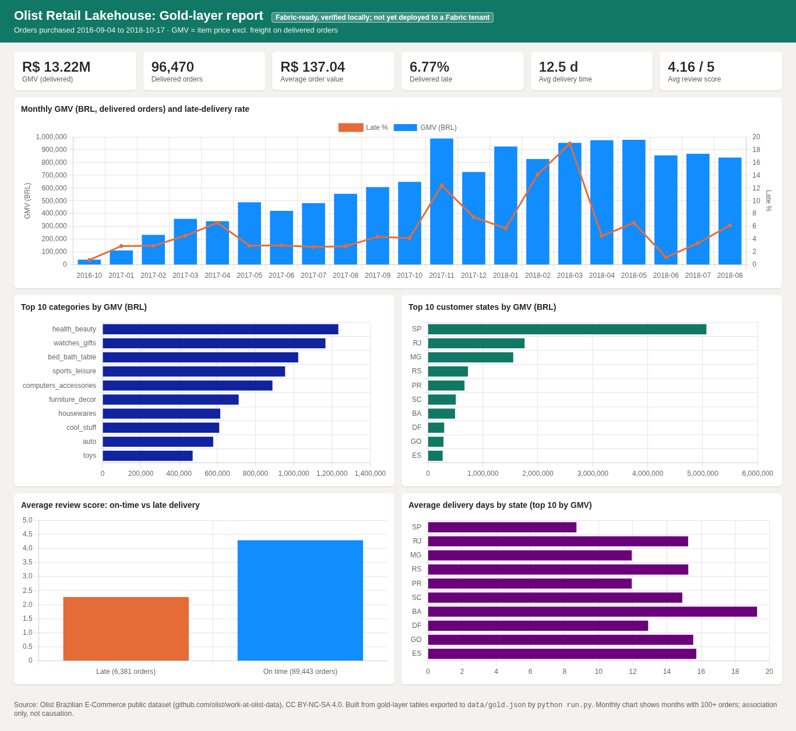

# Olist Retail Lakehouse on Microsoft Fabric (medallion + Direct Lake + TMDL)

**Status: Fabric-ready, verified locally; not yet deployed to a Fabric tenant.**
The bronze, silver and gold notebooks are in Fabric git format and use PySpark/Delta when run in Fabric. For local checks, the same SQL runs on DuckDB. The semantic model is TMDL (Direct Lake), and deployment is scripted with `fabric-cicd`. I had no Fabric account, so the Fabric path itself has not been executed.



## Problem and business questions
An e-commerce marketplace wants one governed lakehouse and semantic model in place of ad-hoc CSV analysis. The project answers these questions:
1. How large is the business: GMV, orders and average order value, and how did they trend month by month?
2. Which product categories and customer states drive GMV?
3. How reliable is delivery: average days, and the share of orders that arrive after the promised date?
4. How strongly is late delivery associated with poor reviews?

## Headline findings (real Olist data, 2016-09-04 to 2018-10-17)
| Metric | Value |
|---|---|
| Orders (all statuses) | 99,441 |
| Delivered orders | 96,470 |
| GMV, delivered orders (item price excl. freight) | R$ 13,220,248.93 |
| Average order value | R$ 137.04 |
| Delivered after the estimated date | 6.77% |
| Average delivery time | 12.5 days |
| Average review score (delivered) | 4.156 / 5 |
| Avg review: on time vs late | 4.29 vs 2.27 |
| 1-2 star reviews: on time vs late | 9.27% vs 62.42% (6.7x) |
| Top category by GMV | health_beauty (R$ 1,233,131.72) |
| São Paulo (SP) share of GMV | 38.32% |

**So what:** late orders get 1-2 star reviews 6.7x as often as on-time ones. That makes delivery-promise accuracy the clearest lever for review scores. This is an association only and does not prove cause.

## Architecture
```
Olist CSVs (publisher GitHub mirror, SHA-256 manifest)
   │  Files/raw/olist  (OneLake)          local: data/raw
   ▼
nb_01_bronze_ingest     all-string Delta tables + _source_file/_ingested_at   (99,441 orders)
   ▼
nb_02_silver_conform    TRY_CAST typing, ROW_NUMBER de-dup, English categories
   ▼
nb_03_gold_star_schema  dim_date/customer/product/seller, fact_orders, fact_order_items, gold_* aggregates
   ├──► OlistRetail.SemanticModel (TMDL, Direct Lake, 5 relationships, 12 DAX measures)
   └──► web/data/gold.json ──► web/index.html (Chart.js, opens from file://)
```
The notebooks include an engine shim. In Fabric, `spark` exists and tables are written with `saveAsTable` (Delta). Locally, `run.py` executes the same `notebook-content.py` files against DuckDB. A small `days_between()` helper is the only dialect switch, along with the calendar generator in `dim_date`.

## Repository layout
| Path | What |
|---|---|
| `fabric/lh_olist_retail.Lakehouse` | Lakehouse item (Fabric git format) |
| `fabric/nb_0*.Notebook/notebook-content.py` | Bronze, silver and gold notebooks (Fabric source format, `synapse_pyspark` kernel) |
| `fabric/OlistRetail.SemanticModel/definition/*.tmdl` | Direct Lake semantic model: tables, relationships, measures |
| `fabric/parameter.yml` | fabric-cicd find/replace for the SQL endpoint and Lakehouse id |
| `scripts/deploy_fabric.py`, `.github/workflows/deploy-fabric.yml` | fabric-cicd publish (manual dispatch only) |
| `docs/FABRIC_DEPLOY.md` | Free-trial and deployment guide (git integration or fabric-cicd) |
| `web/` | Static HTML/JS report built on the gold JSON |
| `tests/` | pytest data-validation and artifact checks |

## Data and licence
- Publisher: Olist, *Brazilian E-Commerce Public Dataset*, mirrored at <https://github.com/olist/work-at-olist-data> (`datasets/*.csv`). Licence: CC BY-NC-SA 4.0.
- `data/manifest.json` records the URL, size and SHA-256 for every file. `scripts/download_data.py` verifies each checksum and skips files that already match.
- Raw files and the DuckDB file are never committed.

## Data issues found (each one is pinned in a test)
- 99,224 review rows cover only 98,673 orders: 1,098 rows belong to orders with more than one review. Silver keeps the latest answered review per order.
- 775 orders have no order items, mostly cancelled or unavailable orders. They stay in `fact_orders` with a value of 0.
- 8 orders have the status `delivered` but no customer-delivery timestamp. They are not counted as delivered.
- Two categories are missing from the official translation table (`pc_gamer` and `portateis_cozinha_e_preparadores_de_alimentos`), and 610 products have no category. These keep their Portuguese name or are labelled `unknown`. They are not dropped.
- 1,085 orders have payments that differ from items plus freight by more than R$1 (vouchers and instalment interest). GMV therefore uses item price, not payments.
- Months at the start and end of the range are sparse (2016 and Sep-Oct 2018). The web chart shows months with 100 or more orders.

## KPI definitions (DAX mirrors the SQL)
| KPI | Definition | DAX |
|---|---|---|
| GMV | Sum of item price on delivered orders, excluding freight | `CALCULATE(SUM(fact_orders[items_value]), fact_orders[is_delivered] = 1)` |
| AOV | GMV / delivered orders | `DIVIDE([GMV], [Delivered Orders])` |
| Late Delivery % | Delivered date > estimated date, over delivered orders | `CALCULATE(AVERAGE(fact_orders[is_late]), …)` |
| Avg Review Score | Mean 1-5 score per order (one review per order) | `CALCULATE(AVERAGE(fact_orders[review_score]), …)` |
| GMV YoY % | Same period last year via `dim_date` | `DIVIDE([GMV] - [GMV PY], [GMV PY])` |

## Reproduce (local verification)
```bash
python -m venv .venv && . .venv/bin/activate
pip install -r requirements.txt && python -m playwright install chromium-headless-shell
python run.py          # download+verify data -> bronze/silver/gold -> TMDL -> gold.json -> README -> screenshots
pytest -q
open web/index.html    # works straight from the file system
```
To deploy to Fabric, see [docs/FABRIC_DEPLOY.md](docs/FABRIC_DEPLOY.md).

## Tests
The pytest suite runs 38 checks:
- Bronze counts match the official Olist counts. Keys are unique, foreign keys resolve and the date dimension has no gaps.
- Facts reconcile to silver, and gold parts sum to the totals.
- The data anomalies above are pinned to their observed counts.
- The Fabric `.platform` metadata is valid, and the notebooks compile as Python.
- TMDL columns match the gold schema exactly, and the DAX GMV equals its SQL mirror.
- The web assets are present offline, and the README matches `kpis.json`.

## Limitations
- The project has **not been deployed to a Fabric tenant**. Spark-specific code paths (`spark.read.csv`, `saveAsTable`, `sequence/explode`) were written for Fabric Runtime 1.3 (Spark 3.5) but were not executed. Only the DuckDB path was run.
- The TMDL was hand-generated and checked structurally plus against the schema. It has not been opened in Power BI Desktop or validated by the XMLA or Fabric APIs. Expect minor fixes on first import.
- No PBIR report pages are included. The report layer is the static web page, and the screenshots are of that page, not of Power BI.
- Olist is a public sample from 2016-2018 and is anonymised. Figures are nominal BRL. Every finding shows correlation only.

## References studied
See [docs/REFERENCES.md](docs/REFERENCES.md).

## Author
Mohammad Amir Khan. Portfolio project built on public data, with no client or employer work.
